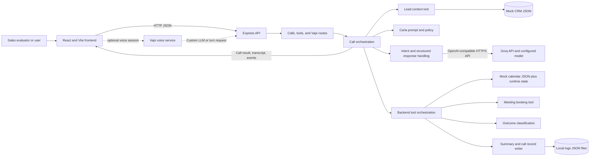
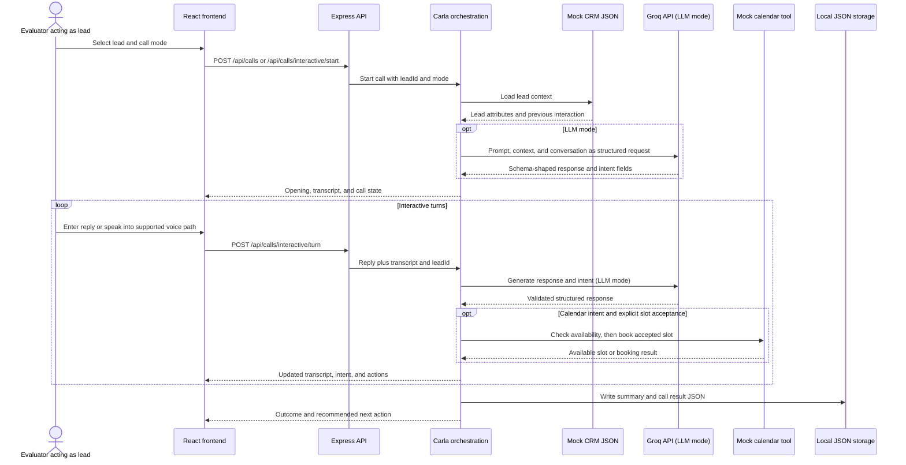
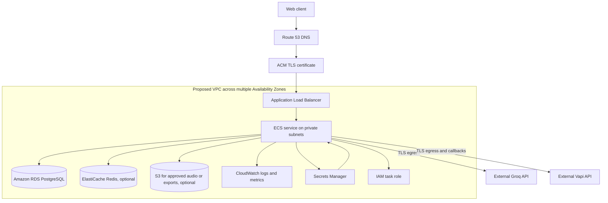

# Carla — AI Voice Sales Development Representative

[](https://react.dev/)
[](https://www.typescriptlang.org/)
[](https://nodejs.org/)
[](https://vite.dev/)
[](https://expressjs.com/)

Carla is a demonstrator for an AI-assisted sales development representative (SDR). A React web app starts scripted or LLM-driven conversations with sample leads. An Express backend supplies lead context, coordinates calendar and summary tools, classifies outcomes, and can connect to Groq for generated responses. Vapi is an optional voice transport. This repository is an MVP: CRM and calendar data are mock JSON, runtime records are local JSON files, and there is no authentication, production database, or deployed cloud infrastructure.

> **Implementation note:** The repository's current code is the source of truth for this README. “Implemented” means present in this codebase; it does not mean independently deployed, externally integrated, load-tested, or production-ready. The AWS and scaling sections describe a possible future design.

## Contents

- [Project overview](#project-overview)
- [What is implemented](#what-is-implemented)
- [Repository structure](#repository-structure)
- [Architecture](#architecture)
- [End-to-end workflow](#end-to-end-workflow)
- [Agentic AI concepts in Carla](#agentic-ai-concepts-in-carla)
- [API reference](#api-reference)
- [Local setup](#local-setup)
- [Implementation status](#implementation-status)
- [Cloud, AWS, DevOps, and LLMOps](#cloud-aws-devops-and-llmops)
- [Scaling strategy](#scaling-strategy)
- [Security and privacy](#security-and-privacy)
- [Commercial feasibility](#commercial-feasibility)
- [Evaluation guideline mapping](#evaluation-guideline-mapping)
- [Five-to-ten-minute demonstration](#five-to-ten-minute-demonstration)
- [Technical evaluation questions](#technical-evaluation-questions)
- [Limitations and roadmap](#limitations-and-roadmap)

## Project overview

Sales teams often spend time on repetitive first-touch conversations, qualifying leads, and deciding which follow-up should happen next. When lead volume grows, manual outreach can become inconsistent and slow. Carla demonstrates a workflow in which an agent can use a lead's stated context to guide a discovery conversation, respond to common objections, offer a meeting when appropriate, and prepare a structured handoff for a human seller.

### Objectives

- Demonstrate scripted and LLM-generated SDR conversations in a web interface.
- Keep conversation policy and orchestration in the backend.
- Use structured model output to capture intent, objections, pain points, and a recommended next action.
- Demonstrate backend tools for lead lookup, mock calendar availability, booking, summary storage, and outcome classification.
- Show an optional voice experience through Vapi and browser audio capabilities.

### Intended users and use cases

The prototype is aimed at technical evaluators and teams exploring sales workflow automation. A future product could serve B2B sales teams, SaaS startups, sales operations, and revenue operations groups. Current demo scenarios include interested, busy, not-interested, budget, existing CRM, email follow-up, authority, and security concerns. These are seeded examples, not evidence of customer deployments.

### Business value and differentiators

The value hypothesis is faster, more consistent first-touch qualification and a cleaner handoff to a human sales representative. Carla's implementation keeps the LLM behind the backend, uses a deterministic mode that works without model credentials, validates model outputs, and requires a specific accepted calendar slot before its interactive flow books a meeting. These are architectural choices in a demo; ROI, conversion improvement, and commercial effectiveness have not been measured.

## What is implemented

| Capability | What the code does | Implementation |
|---|---|---|
| Web call demo | Presents sample leads, call states, transcript, actions, and post-call result in a React UI. | `src/App.tsx`, `src/App.css` |
| Deterministic calls | Runs a scripted scenario based on the selected mock lead. This mode needs no LLM key. | `src/server/calls/callOrchestrator.ts` |
| LLM responses | Uses the OpenAI-compatible SDK pointed at Groq's API endpoint, with `GROQ_MODEL` (default `openai/gpt-oss-20b`). | `src/server/agent/llmCallOrchestrator.ts` |
| Structured output | Requests JSON-schema responses, parses JSON, validates with Zod, and retries recognized format failures once. | `src/server/agent/llmCallOrchestrator.ts` |
| Lead context | Reads lead records from the checked-in CRM mock JSON and supplies company, role, tools, pain hint, topic, previous interaction, and email. | `src/server/tools/getLeadContext.ts`, `src/server/data/crm.mock.json` |
| Intent and objection signals | LLM mode returns typed intent, objection type, calendar decision, next move, and reasoning; conversation turns also extract pain points, objections, interest, and action suggestions. | `src/server/agent/llmCallOrchestrator.ts`, `src/server/types.ts` |
| Objection scenarios | Deterministic examples cover budget, timing, existing tools, authority, and security; interactive LLM mode can respond to user-provided text. | `src/server/calls/callOrchestrator.ts`, `src/server/agent/carlaSystemPrompt.ts` |
| Calendar availability | Filters future, available slots in mock calendar data; bookings update ignored runtime calendar state. | `src/server/tools/checkCalendarAvailability.ts`, `src/server/tools/bookMeeting.ts` |
| Meeting booking | Books a sample slot and returns booking details to the call result. It does not create an external calendar event or send an invite. | `src/server/tools/bookMeeting.ts` |
| Call summaries and outcomes | Produces structured summary fields and rule-based classification, then writes call and summary JSON under ignored `logs/`. | `src/server/tools/saveCallSummary.ts`, `src/server/tools/classifyLeadOutcome.ts`, `src/server/storage/jsonStore.ts` |
| Interactive conversation | Accepts a typed lead reply (or browser speech recognition text), sends transcript and reply to the backend, and returns Carla's next response. | `src/App.tsx`, `src/server/routes/calls.ts`, `src/server/agent/llmCallOrchestrator.ts` |
| Optional Vapi voice | Frontend can start a Vapi web call when its public key and assistant ID are configured. Backend exposes call, webhook, custom LLM, and turn endpoints. Outbound server-created calls are dry-run unless explicitly enabled. | `src/server/vapi/vapiVoiceService.ts`, `src/server/routes/vapi.ts`, `src/App.tsx` |
| API errors | Routes forward exceptions to an Express error handler; Groq errors are mapped to clearer statuses/messages. | `src/server/index.ts`, `src/server/agent/llmCallOrchestrator.ts` |

The LLM does not directly execute arbitrary functions. It emits a structured recommendation; backend code decides and performs supported actions. Calendar and summary operations are local mock/file tools. No email service is integrated: an “email follow-up” is a recommendation for a human, not an email sent by the app.

## Repository structure

```text
.
├── public/                         # Static images and icons
├── src/
│   ├── App.tsx                     # React demo, call controls, transcript and outcomes
│   ├── main.tsx                    # Frontend entry point
│   ├── App.css, index.css          # UI styling
│   └── server/
│       ├── index.ts                # Express app, middleware, health route and error handler
│       ├── agent/
│       │   ├── carlaSystemPrompt.ts
│       │   └── llmCallOrchestrator.ts
│       ├── calls/callOrchestrator.ts # Deterministic demo and mode selection
│       ├── config/agent.config.ts
│       ├── data/                   # Mock CRM and calendar JSON
│       ├── routes/                 # Calls, tools, and Vapi HTTP endpoints
│       ├── storage/jsonStore.ts    # Local JSON reads/writes
│       ├── tools/                  # Lead, calendar, booking, summary, classification
│       ├── types.ts
│       └── vapi/vapiVoiceService.ts
├── .env.example                    # Variable names and safe defaults, no credentials
├── package.json                    # Scripts and dependencies
├── package-lock.json
├── tsconfig*.json
└── vite.config.ts
```

There are no repository test/spec files, Dockerfile, GitHub Actions workflow, Terraform, Kubernetes manifests, or deployment configuration in the inspected project tree. `logs/`, `.env`, `node_modules/`, and build output are ignored by Git.

## Architecture

### Current MVP architecture

Solid arrows show normal application calls. Vapi and Groq are external services; CRM, calendar, and persistence boxes are local mock/file implementations.



The backend listens on `PORT` (default `3001`); Vite's development server defaults to `5173`. The current UI uses a hardcoded `http://localhost:3001` API base. In this checkout, CRM/calendar files are the source of truth for demo data, while meeting state, summaries, and call results are written to local files. Local files are not a multi-instance database.

### Lead conversation sequence



The deterministic call endpoint follows a predefined scenario rather than interpreting arbitrary lead speech. Interactive mode requires Groq and uses caller-provided replies. It is therefore useful to describe the project as an agentic workflow prototype with deterministic and LLM-driven paths, not as an autonomous production SDR.

## End-to-end workflow

Example: a seeded B2B SaaS lead is interested in reducing delayed outbound follow-up.

1. The evaluator selects a lead from `crm.mock.json` in the UI.
2. The UI calls the backend. The backend loads that lead's mock context.
3. In deterministic mode, Carla follows the selected sample scenario. In LLM mode, the backend sends prompt, context, and conversation to Groq.
4. In interactive mode, a person types a lead response or uses the available speech input. The response and transcript go to the backend for the next turn.
5. Carla's prompt guides discovery and objection handling. The LLM produces structured intent and a proposed next action; Zod checks the result.
6. When meeting availability is requested, backend code reads available future slots from the mock calendar. The interactive path checks that a lead accepted a previously offered option before attempting booking.
7. A successful mock booking changes local runtime calendar JSON. It is not a Google/Outlook event and does not send an invitation.
8. The backend compiles pain points, objections, interest, meeting status, and recommended next step; a rule-based classifier labels the outcome.
9. A summary and call result are written as JSON in ignored `logs/` files and returned to the UI.
10. A human seller would perform any recommended email, follow-up, invite delivery, or CRM update outside this MVP.

### Example conversation (illustrative)

This sample paraphrases the product workflow; actual generated wording can vary.

> **Carla:** You mentioned outbound follow-up. Where does the process break down most often?
>
> **Lead:** High-intent leads sometimes wait too long, and reps repeat work across our sales tools.
>
> **Carla:** That sounds frustrating. Is the main challenge prioritizing the right accounts, or coordinating follow-up across tools?
>
> **Lead:** Mostly the handoff. We already use a CRM and don't want to replace it.
>
> **Carla:** That makes sense. The goal would be to explore how an agent could fit around your current workflow. Would a short discovery meeting be useful?
>
> **Lead:** Yes. The second option works for me.

In the demo, Carla can offer mock availability and save a mock booking. Real invite delivery and CRM/calendar synchronization require integrations that are not present here.

## Agentic AI concepts in Carla

An **AI agent** is software that uses a model and application logic to pursue a bounded goal using context and, where authorized, tools. **Agentic AI** describes systems that choose steps toward a goal rather than only returning a single answer. A **traditional chatbot** often follows fixed rules; an **LLM chatbot** generates language from model context; an agentic workflow adds state, decisions, and controlled actions. These labels describe a spectrum, not a guarantee of autonomy.

| Concept | Meaning | Carla's implementation |
|---|---|---|
| LLM reasoning | Model-generated interpretation and response based on prompt and conversation. | Groq-hosted configured model receives system instructions, lead context, and conversation turns. This is model inference, not a trained Carla model. |
| Context management | Supplying relevant facts to a response and preserving conversational state. | Mock CRM lead fields and transcript are sent to the LLM. The frontend sends the transcript on interactive turns; there is no durable session store. |
| Intent detection | Categorizing what a lead said, such as objection or request to schedule. | Structured fields include intent, objection type, calendar signals, next move, and reasoning. |
| Tool calling / orchestration | Selecting application operations and executing them through controlled code. | The model returns a recommended tool name as JSON data. Backend code performs known operations; the model is instructed not to execute or invent tool calls. |
| Autonomous decisions | Decisions made by software without a human choosing each step. | Limited to bounded workflow decisions. Deterministic mode is scripted; LLM mode still relies on backend rules and human follow-up for real-world actions. |
| Human-in-the-loop | A person reviews, approves, or completes consequential work. | Sales must handle follow-up email, real calendar invites, and production CRM actions. The prototype does not provide a review/approval console. |

The Carla system prompt defines role, conversation style, discovery flow, objection handling, tool boundaries, outcome labels, and required output formats. `llmCallOrchestrator.ts` defines JSON schemas and Zod validators, invokes the OpenAI-compatible client at `https://api.groq.com/openai/v1`, and routes validated results through backend tools. `GPT-OSS-20B` is the default model identifier (`openai/gpt-oss-20b`) supplied to Groq; it is not a model trained or hosted by this repository. Vapi can provide a voice connection, while Carla's backend remains responsible for responses and actions.

**Structured JSON is not the same as native function calling.** In this code, a recommended action appears in the model's response data; application code controls execution. This separation is useful for validating inputs and applying business rules, but the demo still needs stronger authorization, session validation, and failure recovery before production use.

## API reference

All routes are mounted by `src/server/index.ts`. The API currently has no authentication or authorization middleware.

| Method and path | Purpose |
|---|---|
| `GET /health` | Basic process health response. |
| `GET /api/agent` | Return Carla's display configuration. |
| `GET /api/leads` | List mock leads. |
| `GET /api/leads/:leadId` | Load one mock lead. |
| `GET /api/calendar/availability` | Return up to three available future mock slots; optional `preferredDate=YYYY-MM-DD`. |
| `POST /api/meetings` | Book a mock slot with `leadId`, `slotId`, and optional `notes`. |
| `POST /api/call-summaries` | Write a submitted summary JSON file. |
| `POST /api/lead-outcomes/classify` | Classify a supplied transcript and optional summary. |
| `POST /api/calls` | Start a deterministic or LLM scripted call using `leadId` and optional `mode`. |
| `POST /api/calls/interactive/start` | Start an interactive LLM call (`mode: "llm"`). |
| `POST /api/calls/interactive/turn` | Submit `callId`, `leadId`, `transcript`, and `leadReply` for the next LLM turn. |
| `GET /api/vapi/config` | Return Vapi configuration status and call limits. |
| `POST /api/vapi/calls` | Plan a Vapi call; creates an outbound call only when explicitly enabled and configured. |
| `POST /api/vapi/webhook` | Acknowledges receipt and reports message type; does not validate webhook signatures. |
| `POST /api/vapi/chat/completions` | Vapi Custom LLM-compatible endpoint that maps messages to Carla's backend turn flow. |
| `POST /api/vapi/turn` | Lower-level transcript-turn bridge. |

## Local setup

### Prerequisites

- Node.js and npm compatible with the installed Vite 8 toolchain. There is no `engines` declaration in `package.json`; use a current supported Node.js release.
- Git.
- Groq API credentials only for LLM and interactive modes.
- Vapi account/configuration only for optional Vapi voice. Browser speech recognition may depend on browser support and permissions.

### Install and run

```bash
git clone https://github.com/uday2327/AI-voice-agent-sales.git
cd AI-voice-agent-sales
npm install
```

Create `.env` from `.env.example` (PowerShell):

```powershell
Copy-Item .env.example .env
```

Set only the variables needed for the selected mode. The deterministic default needs no API keys. For LLM mode, add a valid `GROQ_API_KEY`. To use browser Vapi voice, configure `VITE_VAPI_PUBLIC_KEY` and `VITE_VAPI_ASSISTANT_ID`; configure backend Vapi variables only for the corresponding server features.

```env
GROQ_API_KEY=your_groq_key
GROQ_MODEL=openai/gpt-oss-20b
AGENT_MODE=deterministic
PORT=3001
```

Run frontend and backend together:

```bash
npm run dev
```

Open the Vite URL shown in the terminal (normally `http://localhost:5173`). The backend health endpoint is `http://localhost:3001/health`.

### Environment variables

Names below are from `.env.example`; secrets should be supplied locally and never committed.

| Variable | Purpose / default |
|---|---|
| `GROQ_API_KEY` | Server-side Groq credential; required for LLM calls. |
| `GROQ_MODEL` | Model ID; defaults in code to `openai/gpt-oss-20b`. |
| `AGENT_MODE` | `deterministic` or `llm`; code defaults to deterministic. |
| `MAX_CALL_TURNS` | LLM scripted lead-turn cap (default 8; code caps at 10). |
| `MAX_INTERACTIVE_LEAD_TURNS` | Interactive turn limit (default 6; code caps at 8). |
| `MAX_OUTPUT_TOKENS` | LLM output token cap (default 220; code caps at 500). |
| `PORT` | Express port (default 3001). |
| `VITE_VAPI_PUBLIC_KEY` | Browser-facing Vapi public key for optional voice. |
| `VITE_VAPI_ASSISTANT_ID` | Vapi assistant ID used by the web client. |
| `VAPI_API_KEY` | Server-side Vapi credential for server-created outbound calls. |
| `VAPI_PUBLIC_BASE_URL` | Publicly reachable backend base URL for configured Vapi callbacks/custom LLM. |
| `VAPI_ALLOW_OUTBOUND_CALLS` | Must be `true` to allow server-created outbound Vapi calls; otherwise dry-run. |
| `VAPI_MAX_OUTBOUND_CALLS` | In-memory per-process call cap (default 2, code caps at 10). Resets on restart. |
| `VAPI_MAX_CALL_DURATION_SECONDS` | Requested call duration limit (default 300, code caps at 900). |

`VAPI_PHONE_NUMBER_ID` is referenced by the server code for real outbound calls but is missing from `.env.example`; set it in the local environment if testing that path. `VAPI_ASSISTANT_ID` is also read by backend code but the example lists only its Vite counterpart. `VAPI_PHONE_NUMBER_ID` and backend `VAPI_ASSISTANT_ID` are not safe to expose in frontend variables. For Vite, variables prefixed with `VITE_` are embedded in client assets and should contain public values only.

### Available npm scripts

| Command | What it runs |
|---|---|
| `npm run dev` | Concurrent Vite frontend and `tsx watch` backend. |
| `npm run dev:client` | Vite development server. |
| `npm run dev:server` | Express backend with file watch/restart. |
| `npm run build` | TypeScript project build followed by Vite production build. |
| `npm run lint` | Oxlint. |
| `npm run preview` | Vite preview server for an existing frontend build. |
| `npm start` | Start Express backend with `tsx`; it does not serve the built frontend. |

There is no `test` script or test suite in this repository. `npm run build` and `npm run lint` are available checks; their presence is not a claim that they have passed in every environment.

### Troubleshooting

- **LLM says `GROQ_API_KEY` is missing:** Add it to `.env` in `SDR_CallingAgent` and restart the backend.
- **Groq returns 401/403:** Check key validity and server-side environment loading. Never paste the key into an issue or transcript.
- **Groq returns 429:** Provider quota/rate limits have been reached; wait or review the Groq account's current limits.
- **Structured output rejected:** The selected model/provider must support the requested JSON schema response format. Check `GROQ_MODEL` and provider support.
- **Frontend cannot reach API:** Confirm both dev processes are running and backend listens on port 3001. The frontend currently targets `localhost:3001` directly.
- **Vapi voice fails:** Check public key, assistant ID, assistant Custom LLM configuration, browser microphone permissions, and reachable backend URL. The sample `.env.example` does not include every Vapi variable used in code.
- **No meeting slot appears:** The tool filters for future available slots. Seed calendar dates can become stale; this mock calendar is not synchronized with a real calendar.

## Implementation status

| Area | Status | Evidence and boundary |
|---|---|---|
| Frontend and backend MVP | Implemented | React/Vite UI, Express routes, health endpoint, and demo call flows exist. |
| Deterministic conversation scenarios | Implemented | Fixed examples selected from mock lead scenarios; not free-form AI. |
| Groq LLM response generation | Implemented, configuration required | OpenAI-compatible SDK uses Groq base URL and structured responses. Actual provider availability depends on a valid key/model. |
| Intent and objection analysis | Implemented in LLM mode | Structured fields are parsed and validated; deterministic scenarios use scripted outcomes. |
| Mock lead context | Implemented | JSON fixtures only; no external CRM connection. |
| Mock calendar lookup and booking | Implemented | Local JSON and runtime state; no external calendar or invite delivery. |
| Transcript, call summary, classification | Implemented for app flows | Returned and saved as local JSON; classification is rules-based. Not durable or shared storage. |
| Interactive text conversation | Implemented, Groq required | UI submits user replies and history to LLM backend. |
| Browser speech input | Partially implemented | Uses browser speech recognition when supported and permitted; it sends recognized text through the interactive flow. |
| Vapi voice | Partially implemented / configuration-dependent | Vapi Web SDK and server endpoints exist. A working external assistant and deployed public backend are not included. |
| Vapi outbound dialing | Partially implemented, disabled by default | Server SDK call creation exists behind env checks and in-memory cap. No evidence of configured phone number or production webhook security. |
| Email follow-up | Proposed/manual | Recommendations are generated; there is no email integration. |
| Authentication, roles, tenant isolation | Not implemented | No auth middleware or user/tenant model found. |
| Production database, observability, cloud deployment | Not implemented | JSON files and console output; no database/cloud configs in repo. |
| Tests and CI/CD | Not implemented in repository | No tests, test script, or CI workflow found. |

## Cloud, AWS, DevOps, and LLMOps

### Cloud computing perspective

A hosted voice application needs compute for its API and orchestration, storage for application records, networking to expose HTTPS endpoints, and a database for concurrent durable state. Load balancing and horizontal capacity become relevant when simultaneous API requests or voice sessions exceed a single process. Availability requires health checks, backups, deployment rollback, and failure handling. The MVP uses one local Node process, local JSON files, and external Groq/Vapi APIs; it is not currently a cloud deployment.

### Proposed AWS production architecture

The diagram below is a **proposal only**. No AWS resources are declared or deployed by this repository.



| AWS service | Proposed role |
|---|---|
| Amazon VPC, public/private subnets | Isolate network boundaries; expose the load balancer publicly and keep application/database resources private. Use multiple AZs for resilience. |
| Application Load Balancer | Terminate/route HTTPS traffic and distribute requests to healthy backend tasks. |
| ECS (Fargate or EC2 capacity) | Run containerized stateless API/orchestration processes. EC2 is an alternative when host-level control is needed. |
| RDS PostgreSQL | Durable relational data for tenants, leads, call sessions, bookings, and audit metadata. Select Multi-AZ/backups based on recovery needs. |
| ElastiCache Redis (optional) | Short-lived rate-limit counters, session/cache data, and coordination; not the sole durable source of truth. |
| S3 (optional) | Store approved recordings, exports, or artifacts with encryption, retention, and access controls. Avoid storing audio unless product/legal requirements justify it. |
| IAM | Least-privilege task roles and deployment identities; avoid long-lived embedded AWS credentials. |
| Secrets Manager | Store and rotate server-side provider credentials, database secrets, and webhook secrets. |
| CloudWatch | Central logs, metrics, alarms, dashboards, and operational investigations. Redact personal data and credentials. |
| Auto Scaling | Adjust ECS task count using request/CPU/memory and queue or active-session metrics. Set sensible minimums and quotas. |
| Route 53 and ACM | DNS routing and managed TLS certificates for public API endpoints. |

Vapi and Groq remain external providers in this design. Network egress, webhook validation, retry policy, provider data terms, and regional data handling need explicit review before a real launch.

### DevOps delivery model

Git and GitHub provide source history and collaboration. A production pipeline could use GitHub Actions to install from the lockfile, lint, type-check/build, run unit/integration tests, scan dependencies and images, build a Docker image, publish it to ECR, then deploy to a staging ECS service. A protected approval step could promote a tested image to production with health checks and rollback. Environment-specific settings should be injected from Secrets Manager, not committed to Git.

Docker would package the API and frontend deployment artifact reproducibly. Terraform could version VPC, ECS, RDS, IAM, alarms, and DNS configuration. Ansible is generally more relevant if managing EC2 hosts; with ECS/Fargate it may be unnecessary. Linux operations cover process/container health, patching where applicable, log review, and incident response. These are recommended practices; this repository currently contains no Docker, Terraform, Ansible, Jenkins, or GitHub Actions configuration.

### MLOps and LLMOps

Traditional MLOps often covers training data, feature pipelines, model training, evaluation, registry, deployment, and drift. Carla does not train or deploy its own model. LLMOps applies operational discipline to hosted model use: provider/model selection, prompt versioning, schema validation, evaluation sets, latency and token tracking, rate-limit management, safety review, and monitoring output quality.

Carla already has a configurable model name, a backend prompt, token and turn caps, provider error handling, JSON schema output, and Zod validation. A production LLMOps extension could add versioned prompt artifacts, offline scenario evaluation, redacted traces, schema/quality metrics, latency and token-cost dashboards, provider/model fallback, quota controls, adversarial prompt tests, and human review sampling. No such evaluation or monitoring system is included here. Input text remains untrusted: system prompts help guide behavior but are not a complete prompt-injection defense.

### How the layers connect

```text
Frontend → Backend API → Agent orchestration → Groq LLM (when enabled)
                                      ├→ CRM/calendar/summary tools
                                      └→ Vapi voice transport (optional)
Cloud infrastructure hosts and protects the API/data; CI/CD ships changes;
monitoring tracks application, provider, cost, latency, and failure signals.
```

## Scaling strategy

**The current MVP has no demonstrated capacity target.** Registered users, concurrent active users, simultaneous voice sessions, and requests per second are different measures. “100,000 users” cannot be translated into a hardware size without an activity profile, call duration, turn rate, provider quotas, data retention, and latency goals. No benchmark or load test is present.

### Evolution path

| Stage | Possible design and prerequisites |
|---|---|
| MVP | One Node process, Vite UI, mock JSON fixtures, local ignored logs. Suitable for a controlled demo only. |
| Initial production | Containerized stateless API behind HTTPS load balancer; managed SQL database; migrations and backups; authentication/tenant model; centralized logs/metrics; provider quotas and webhook verification. |
| 10,000 registered users | Measure active-user and voice concurrency patterns. Horizontally scale API tasks; add DB connection pooling, indexes, request limits, queue-backed long jobs, and Redis only where measured cache/coordination needs justify it. |
| 100,000 registered users | Multi-AZ services, partitioning/retention strategy where data volume warrants it, robust queue workers, provider quota agreements, tenant isolation, autoscaling, disaster recovery, and capacity/load tests at defined concurrent sessions and requests per second. |

### Engineering controls to add

- **Stateless API and horizontal scaling:** Store session/call state in a shared durable database or explicitly designed cache, not process memory or local files. Keep API tasks replaceable.
- **Load balancing and connection pooling:** Distribute API traffic; bound application-to-database connections so scale-out does not exhaust the database.
- **Async work and queues:** Move post-call summarization, exports, and noninteractive follow-up jobs to a queue/worker when their latency or retry needs justify it. Voice turn responses must still meet conversational latency goals.
- **Caching and indexing:** Cache safe, frequently read reference data if measured; index tenant, lead, call, and time-based query patterns. Invalidate on updates.
- **Rate and quota management:** Limit per-user/tenant API traffic and concurrent calls. Track provider quotas, apply backpressure, and handle 429 responses with bounded retry/backoff.
- **Concurrent voice sessions:** Capacity-plan Vapi limits, backend turn traffic, STT/TTS, LLM requests, and per-session timeouts together. Voice concurrency is not equivalent to registered-user count.
- **Fault tolerance and recovery:** Define timeouts, idempotency keys for bookings, safe retries, dead-letter handling, backups, restore tests, RPO/RTO, and provider outage behavior.
- **Monitoring and autoscaling:** Scale on meaningful signals such as queue depth, request latency, active sessions, and saturation, not user registrations alone.

Before claiming support for a target, define workload assumptions and SLOs, test representative scripts and peak concurrency, measure p50/p95/p99 latency, errors, database saturation, provider throttling, and cost, then repeat after material changes.

## Security and privacy

### Present controls and limitations

- `.env` is ignored by Git and `.env.example` contains variable names without live keys.
- Groq credentials are read in backend code; Vite-prefixed variables are intentionally public client configuration.
- Deterministic mode avoids model API usage. Vapi server outbound calls default to dry-run and require an explicit enable flag, IDs, key, and customer number.
- The backend caps model tokens/turns and Vapi duration/outbound call count in process memory.
- Model output is schema-validated before normal orchestration uses it.

These controls are useful demo safeguards, not a complete security program. The API currently enables broad CORS, accepts JSON request bodies, exposes business routes without authentication/authorization, does not validate Vapi webhook signatures, and has no tenant isolation, persistent audit trail, or secure database. Error responses may include provider error messages. Local transcript and summary JSON may contain names, emails, and conversation text. No recording-retention or consent workflow is implemented.

### Recommended production controls

- Put the API behind HTTPS/TLS; authenticate users and authorize every lead, call, and tenant resource.
- Validate request bodies with schemas and enforce size, duration, concurrency, and per-tenant rate limits.
- Verify Vapi webhook signatures and timestamps; use idempotency for callbacks and bookings.
- Keep Groq/Vapi/database secrets server-side in Secrets Manager and use least-privilege IAM task roles. Rotate credentials and audit access.
- Encrypt data in transit and at rest; restrict database/network access; redact secrets and personal data from logs.
- Set retention and deletion policies for transcripts and any recordings. Obtain required consent before recording or processing voice data, and review provider terms and applicable law for the operating region.
- Back up persistent data and test restore procedures; document incident response and access review.
- Treat lead-provided text as untrusted input. Constrain available actions in code, validate model output, avoid placing secrets in prompts, and require human review for consequential or uncertain actions.

## Commercial feasibility

Carla could become a B2B SaaS offering if customer discovery validates a specific workflow and measurable value. Potential buyers include sales development, revenue operations, and SaaS businesses with high volumes of first-touch qualification. The current sample app does not include tenant management, CRM integrations, user accounts, billing, compliance controls, or production reporting, so commercial readiness requires substantial additional work.

### Pricing and unit economics framework

Possible pricing models include a base subscription per workspace, seat-based tiers, and usage charges for voice minutes or completed conversations. A hybrid plan can align fixed platform access with variable provider consumption. Do not set price from this prototype; verify current Groq, Vapi, telephony, cloud, and observability rates before modeling.

Estimate per-customer gross cost over a billing period as:

```text
fixed allocated platform cost
+ (voice minutes × current voice/telephony rate)
+ (LLM input tokens × input-token rate + output tokens × output-token rate)
+ storage, database, network, and observability allocation
+ support, payment processing, and operational overhead
```

Fixed costs include baseline API/database capacity, security, and support. Variable costs include model tokens, speech recognition/synthesis, telephony minutes, and data egress/storage growth. Per-customer costs depend on seats, calls, call length, turns, retention, retries, and support load. Check live vendor pricing, discounts, quotas, and taxes when building a business case.

ROI should compare the incremental monthly platform/provider cost to measurable value: qualified meetings, response-time reduction, rep hours recovered, and conversion through the funnel. Use a pilot with a baseline and control group where practical; do not infer ROI from the scripted demo.

## Evaluation guideline mapping

| Evaluation requirement | How Carla addresses it | Evidence / demonstration | Status |
|---|---|---|---|
| Functional MVP or working prototype developed individually. | This repository contains a runnable web/backend demo; individual authorship should be confirmed by the presenter. | Run the local setup and show call flow. | Requires Verification |
| Any programming language, framework, AI model, API or open-source technology. | TypeScript, React, Vite, Express, Groq API, Vapi SDK, Zod, and Node.js appear in the code/dependencies. | `package.json`, `src/`. | Implemented |
| AI-assisted development tools permitted. | This is an evaluation/process requirement, not a runtime feature. | Explain tools used truthfully if asked. | Requires Verification |
| Source code available for technical evaluation. | Source and package lock are present in the repository. | GitHub repository and source tree. | Implemented |
| System architecture diagram. | Current MVP and proposed AWS diagrams are included above. | Mermaid diagrams in this README. | Implemented |
| At least one complete end-to-end business workflow. | Lead-to-call-to-summary workflow is described; seed scenarios provide a demo path. | Run interested or objection scenario. | Partially Implemented |
| Business problem, technical implementation and commercial feasibility. | Overview, implementation, and commercial framework are documented. | Sections above. | Implemented |
| Scalability strategy supporting up to 100,000 users. | A staged proposal and validation needs are described; capacity is not currently proven. | Scaling strategy section. | Proposed |
| Data security, infrastructure, deployment and operational costs. | Existing controls/limitations and future infrastructure/cost model are documented. | Security, AWS, and commercial sections. | Partially Implemented |
| Live coding, debugging and real-time modifications. | The TypeScript project can be edited and rebuilt, but live evaluation is not evidenced by repository files. | Presenter can change a prompt or scenario and rebuild. | Requires Verification |

## Five-to-ten-minute demonstration

1. Explain the sales follow-up problem and Carla's bounded goal (about 1 minute).
2. Show the lead selector and clarify that records/calendar are fixtures (about 1 minute).
3. Run deterministic mode to show a repeatable complete scenario without API credentials (about 2 minutes).
4. Show transcript, tool activity, meeting state, summary, and classification; explain that the calendar booking is local mock state (about 1 minute).
5. If a valid Groq key is available, run LLM scripted or interactive mode and demonstrate a contextual reply or objection. Do not expose the key (about 2 minutes).
6. Optionally demonstrate voice only if Vapi is configured and working; otherwise show the endpoint/UI configuration without claiming a live external call (about 1 minute).
7. Close with backend orchestration, proposed AWS design, and the evidence needed to validate 100,000 registered users (about 2 minutes).

## Technical evaluation questions

### 20 general project questions

1. **What problem does Carla address?** It demonstrates first-touch lead qualification and structured handoff for repetitive sales outreach.
2. **What runs in the frontend?** React 19 and TypeScript through Vite; the UI presents leads, call state, transcript, and outcomes.
3. **What runs in the backend?** Node.js/TypeScript and Express provide API routes, orchestration, tools, and provider calls.
4. **How do I run it?** Install dependencies, configure `.env` as needed, then run `npm run dev` from `SDR_CallingAgent`.
5. **Does the basic demo need an LLM key?** No. Deterministic mode is the default and uses scripted flows.
6. **How is Groq used?** An OpenAI-compatible SDK client calls Groq's API endpoint using `GROQ_API_KEY` and `GROQ_MODEL`.
7. **Is Carla's model trained here?** No. The app sends inference requests to a configured hosted model.
8. **How is model output checked?** JSON is parsed and validated against Zod schemas; recognized structured-output failures receive one retry.
9. **Does the LLM call tools directly?** No. It recommends a tool in structured data; backend code controls operations.
10. **Where does lead data come from?** `src/server/data/crm.mock.json`.
11. **Is there a real CRM integration?** No. The current project reads mock data only.
12. **How is calendar availability read?** A tool filters future available slots from seed or local runtime JSON.
13. **Does booking send an invite?** No. It marks a mock slot booked and returns a result; no external calendar or email integration exists.
14. **How are outcomes classified?** A deterministic text/summary rule function classifies the result.
15. **Where are summaries stored?** Local JSON files under ignored `logs/` at runtime.
16. **Does the app have login or roles?** No authentication or authorization implementation was found.
17. **What is Vapi's role?** Optional voice transport; backend orchestration is intended to remain the conversation brain.
18. **Is outbound calling enabled by default?** No. Server-created outbound calls are dry-run unless `VAPI_ALLOW_OUTBOUND_CALLS=true` and required config is present.
19. **What checks/scripts are present?** `npm run build` and `npm run lint`; there is no test script or checked-in test suite.
20. **What is the main production gap?** Durable multi-tenant data and security, external CRM/calendar integration, operational deployment/monitoring, and verified capacity.

### 10 Agentic AI questions

1. **Why call it agentic?** It combines context, intent interpretation, action selection, and controlled backend tools in a bounded workflow.
2. **What makes it more than a fixed chatbot?** LLM mode interprets free-form turns into structured signals and chooses a next response; deterministic mode itself remains scripted.
3. **What does the system prompt do?** Defines Carla's role, conversation policy, boundaries, and expected response shapes.
4. **What is context management here?** Supplying mock lead facts and transcript turns to the model; state is not persisted in a session database.
5. **How is intent represented?** Enumerated labels and booleans in a schema-validated JSON object.
6. **What does tool calling mean in this design?** Backend tool functions are invoked by application logic; the model supplies recommendations rather than executable code.
7. **How are objections handled?** The prompt and deterministic examples address common objections; interactive behavior is generated and should be evaluated.
8. **What is human-in-the-loop?** Sales staff review uncertain outcomes and perform real follow-up; there is no dedicated approval UI yet.
9. **How are hallucinations limited?** Context, prompt constraints, enums, schema validation, and server-controlled actions reduce risk but cannot eliminate it.
10. **What is the role of GPT-OSS-20B?** It is the default model identifier requested through Groq; Carla neither trains nor hosts it.

### 10 Cloud and DevOps questions

1. **Is the app deployed on AWS?** No; the AWS architecture is proposed documentation.
2. **Why use a load balancer?** To route requests to healthy horizontally scaled API tasks and provide a stable entry point.
3. **Why ECS?** It can run replaceable API containers without requiring a custom Kubernetes platform for this service.
4. **Why use private subnets?** To keep app and database resources off direct public ingress while allowing controlled egress.
5. **Why RDS?** Durable relational storage for tenant, lead, session, and booking records with managed backups and recovery options.
6. **What would Secrets Manager store?** Server-side provider and database credentials, accessed through least-privilege IAM roles.
7. **What would CloudWatch monitor?** Logs, latency, errors, resource saturation, provider failures, and alarms, with sensitive data redacted.
8. **How could GitHub Actions fit?** Build, lint, test, scan, publish an image, deploy staging, then gated production promotion.
9. **Why Terraform?** To version and review cloud infrastructure as code and recreate environments consistently.
10. **What is the current CI/CD state?** No workflow, Dockerfile, Terraform, or deployment config is included in the project tree.

### 10 scalability and security questions

1. **Does it support 100,000 users now?** There is no evidence or load test to make that claim.
2. **What does 100,000 users mean?** Define registered users separately from active users, requests per second, and simultaneous voice sessions.
3. **How should API instances scale?** Make request handlers stateless and store shared state in managed services, then scale tasks behind a load balancer.
4. **Why replace JSON files?** Local files are unsafe for concurrent multi-instance writes and are not a durable shared database.
5. **Why use a queue?** To isolate retryable or slow background work from interactive HTTP/voice turns.
6. **How would rate limiting work?** Apply authenticated per-user/tenant quotas and concurrency limits using a shared counter or gateway policy.
7. **How should provider limits be handled?** Track quotas, bound concurrency, handle 429 responses with backoff, and surface degraded states.
8. **How are secrets protected now?** Local `.env` is gitignored and server code reads provider keys; production needs a secret manager and rotation.
9. **How should transcripts be protected?** Access control, encryption, retention/deletion policy, redacted logs, and consent where required.
10. **How would disaster recovery be validated?** Set recovery objectives, enable backups, and run restore/failover exercises while measuring RPO/RTO.

## Limitations and roadmap

Potential next steps, in order of production importance:

1. Add request validation, authentication/authorization, tenant boundaries, Vapi webhook authentication, and security-focused error/log handling.
2. Replace local JSON persistence with a transactional database and migrations; define session lifetime and idempotent meeting booking.
3. Add real CRM, calendar, and email integrations with human approval and audit trails.
4. Add automated unit/integration/evaluation tests for deterministic scenarios, structured output, objections, scheduling consent, and provider failures.
5. Add Docker, CI/CD, infrastructure as code, secrets management, metrics, traces, alerts, backups, and deployment rollback.
6. Run cost, latency, reliability, security, and representative concurrency tests before publishing service capacity claims.

## License

`package.json` declares this project `UNLICENSED`. Confirm the intended distribution terms with the repository owner before reuse.
